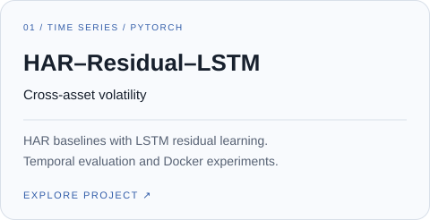
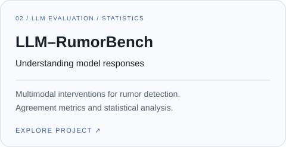
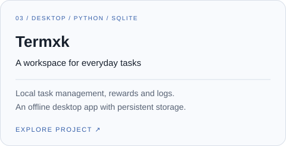

<picture>
  <source media="(prefers-color-scheme: dark)" srcset="assets/portfolio/hero-en-dark.svg" />
  
</picture>

<strong>English</strong> &nbsp; / &nbsp; <a href="README.zh-CN.md">简体中文</a>

<a href="#research">Research</a> &nbsp; / &nbsp; <a href="#selected-work">Selected Work</a> &nbsp; / &nbsp; <a href="#toolkit">Toolkit</a> &nbsp; / &nbsp; <a href="#activity">Activity</a>

I work on machine learning, time-series forecasting and LLM evaluation, and build software for everyday use. This is a collection of my research experiments, open-source projects and systems work.

---

## Research

### 01 / Cross-Asset Volatility Forecasting

**Cross-Asset Volatility Forecasting with HAR-Guided LSTM Residual Learning**

`IIIHSMP · Accepted`

Developed a hybrid HAR–LSTM forecasting model using financial data from multiple sources, covering data cleaning and integration, comparative experiments, and result visualization.

[Model implementation & extensions ↗](https://github.com/Lichao-Lin/HAR-Residual-LSTM)

### 02 / Rumor Detection in Large Language Models

**Evaluating the Impact of Multimodal Cognitive and Informational Interventions on Rumor Detection in Large Language Models: A DeepSeek Case Study**

`IEEE Xplore · Indexed` &nbsp; `EI Compendex · Indexed`

Studied how multimodal cognitive and informational interventions affect rumor detection in large language models through a multi-perspective evaluation framework. Used Python for data processing and statistical analysis, applying Spearman correlation, Cohen’s κ, and weighted κ to assess agreement between model outputs and ground-truth labels and interpret the findings from multiple perspectives.

[Paper DOI ↗](https://doi.org/10.1109/CAIBDA65784.2025.11183156) &nbsp; · &nbsp; [Experiment Repository ↗](https://github.com/Lichao-Lin/LLM-RumorBench)

## Selected Work

<table>
<tr>
<td width="50%" valign="top"><a href="https://github.com/Lichao-Lin/HAR-Residual-LSTM"><picture>
  <source media="(prefers-color-scheme: dark)" srcset="assets/portfolio/har-en-dark.svg" />
  
</picture></a></td>
<td width="50%" valign="top"><a href="https://github.com/Lichao-Lin/LLM-RumorBench"><picture>
  <source media="(prefers-color-scheme: dark)" srcset="assets/portfolio/rumor-en-dark.svg" />
  
</picture></a></td>
</tr>
<tr>
<td width="50%" valign="top"><a href="https://github.com/Lichao-Lin/TaskPool"><picture>
  <source media="(prefers-color-scheme: dark)" srcset="assets/portfolio/termxk-en-dark.svg" />
  
</picture></a></td>
<td width="50%" valign="top"><a href="https://github.com/Lichao-Lin/Scrapy-Travel-Recommender"><picture>
  <source media="(prefers-color-scheme: dark)" srcset="assets/portfolio/travel-en-dark.svg" />
  
</picture></a></td>
</tr>
</table>

More research tools: [research-scripts ↗](https://github.com/Lichao-Lin/research-scripts)

## Toolkit

| Area | Tools & practice |
| :--- | :--- |
| Programming & data | Python · SQL · C++ · Shell |
| Machine learning | PyTorch · scikit-learn · XGBoost · SHAP |
| Research workflow | pandas · Data preparation · Statistical analysis · Forecast comparison · Visualization |
| Systems & automation | Docker · Kubernetes · Servers · NAS · PLC |

Languages & qualifications

College English Test, Band 6 (CET-6) · Low-Voltage Electrician Certificate

## Activity

  
  

Public, non-archived original repositories · Refreshed daily · Language share reflects code volume, not proficiency

Powered by <a href="https://github.com/Lichao-Lin/github-readme-stats">GitHub Readme Stats</a>

