  

  <strong>Hi, I'm Lichao Lin.</strong> 
  Graduated from Minjiang University · 闽江大学毕业 
  金融时间序列预测 · 大语言模型评估 · 数据分析与系统实践

  <a href="#github-at-a-glance">代码概览</a> &nbsp; / &nbsp;
  <a href="#research--publications">研究与论文</a> &nbsp; / &nbsp;
  <a href="#selected-work">精选项目</a> &nbsp; / &nbsp;
  <a href="#tools--systems">技术与工具</a> &nbsp; / &nbsp;
  <a href="#qualifications">语言与资质</a>

---

## GitHub at a Glance

  
  

公开、未归档的原创仓库统计 · 自动更新 · 语言分布反映代码量，不代表熟练程度

## Research & Publications

### 01 / Cross-Asset Volatility Forecasting

**Cross-Asset Volatility Forecasting with HAR-Guided LSTM Residual Learning**

`IIIHSMP · 会议接收`

基于多源金融数据构建 HAR–LSTM 融合深度学习预测模型，完成数据清洗与整合、方案对比和结果可视化。

### 02 / Rumor Detection in Large Language Models

**Evaluating the Impact of Multimodal Cognitive and Informational Interventions on Rumor Detection in Large Language Models: A DeepSeek Case Study**

`IEEE Xplore · 已收录` &nbsp; `EI Compendex · 已收录`

分析多模态认知与信息干预对大语言模型谣言识别能力的影响，构建多视角评估体系。使用 Python 进行数据处理与统计分析，采用 Spearman 相关系数、Cohen’s κ 和加权 κ 等指标，比较模型输出与真实标签的一致性，并对实验结果进行多维度解释。

[论文 DOI ↗](https://doi.org/10.1109/CAIBDA65784.2025.11183156) &nbsp; · &nbsp; [实验仓库 ↗](https://github.com/Lichao-Lin/LLM-RumorBench)

---

## Selected Work

  
  

  
  

## Tools & Systems

| 方向 | 技术与工具 |
| :--- | :--- |
| Programming | Python · SQL · C++ · Shell |
| Infrastructure | Server · Docker · Kubernetes (K8s) · NAS |
| Automation | PLC |
| Research | 数据清洗与整合 · 统计分析 · 预测方案对比 · 结果可视化 |

[科研脚本 ↗](https://github.com/Lichao-Lin/research-scripts) &nbsp; · &nbsp; [学习笔记与技能 ↗](https://github.com/Lichao-Lin/notebook)

## Qualifications

- **英语六级（CET-6）**
- **低压电工证**

Cards powered by <a href="https://github.com/Lichao-Lin/github-readme-stats">GitHub Readme Stats</a>

