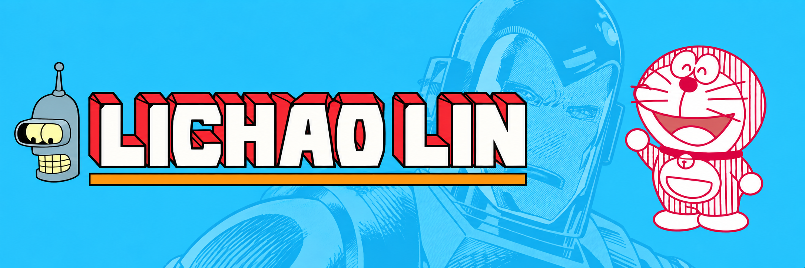
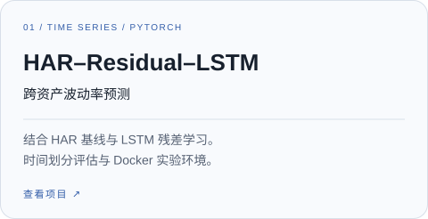
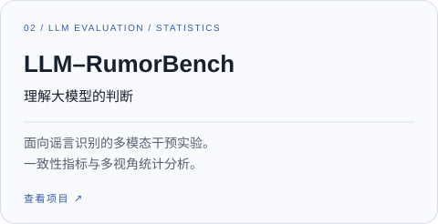
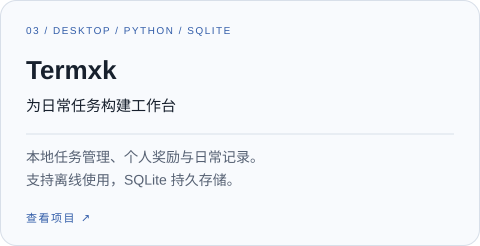
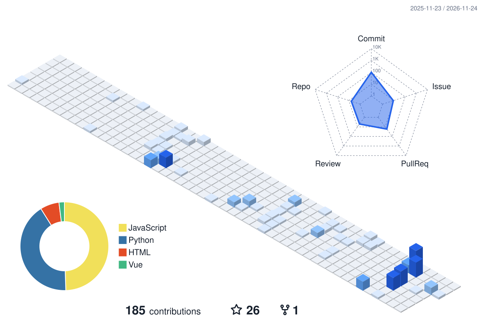
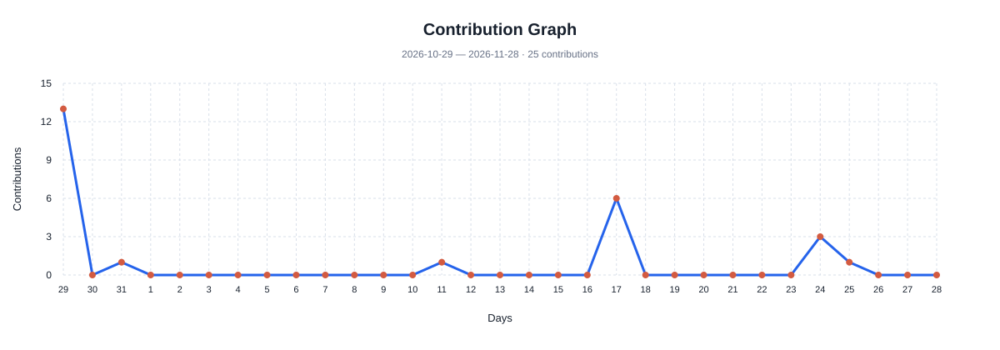

  

<a href="README.md">English</a> &nbsp; / &nbsp; <strong>简体中文</strong>

<a href="#selected-work">精选项目</a> &nbsp; / &nbsp; <a href="#activity">贡献可视化</a> &nbsp; / &nbsp; <a href="#toolkit">技术栈</a> &nbsp; / &nbsp; <a href="#research">研究与论文</a>

关注机器学习、时间序列预测与大语言模型评估，也开发日常使用的软件工具。这里记录我的研究实验、开源项目与系统实践。

---

## 精选项目

<table>
<tr>
<td width="50%" valign="top"><a href="https://github.com/Lichao-Lin/HAR-Residual-LSTM"><picture>
  <source media="(prefers-color-scheme: dark)" srcset="assets/portfolio/har-zh-dark.svg" />
  
</picture></a></td>
<td width="50%" valign="top"><a href="https://github.com/Lichao-Lin/LLM-RumorBench"><picture>
  <source media="(prefers-color-scheme: dark)" srcset="assets/portfolio/rumor-zh-dark.svg" />
  
</picture></a></td>
</tr>
<tr>
<td width="50%" valign="top"><a href="https://github.com/Lichao-Lin/TaskPool"><picture>
  <source media="(prefers-color-scheme: dark)" srcset="assets/portfolio/termxk-zh-dark.svg" />
  
</picture></a></td>
<td width="50%" valign="top"><a href="https://github.com/Lichao-Lin/Scrapy-Travel-Recommender"><picture>
  <source media="(prefers-color-scheme: dark)" srcset="assets/portfolio/travel-zh-dark.svg" />
  
</picture></a></td>
</tr>
</table>

更多研究工具：[research-scripts ↗](https://github.com/Lichao-Lin/research-scripts)

## 贡献可视化

<picture>
  <source media="(prefers-color-scheme: dark)" srcset="profile-3d-contrib/profile-blue-dark.svg" />
  
</picture>

<picture>
  <source media="(prefers-color-scheme: dark)" srcset="assets/activity/activity-dark.svg" />
  
</picture>

近一年贡献日历的 3D 可视化 · 最近 31 天的每日贡献折线 · 基于 GitHub 真实贡献数据，每日自动更新

  
  

公开、未归档的原创仓库 · 每日自动更新 · 语言分布反映代码量，不代表熟练程度

Powered by <a href="https://github.com/Lichao-Lin/github-readme-stats">GitHub Readme Stats</a>

<!-- Technology icons: Devicon (MIT), https://github.com/devicons/devicon. See assets/stack/LICENSE. -->

<!-- 3D calendar generated with https://github.com/yoshi389111/github-profile-3d-contrib -->

## 技术栈

  
  
  
  
  
  
   
  
  
  
  
  
  

| 方向 | 技术与实践 |
| :--- | :--- |
| 编程与数据 | Python · SQL · C++ · Shell |
| 机器学习 | PyTorch · scikit-learn · XGBoost · SHAP |
| 研究流程 | pandas · 数据清洗 · 统计分析 · 预测对比 · 可视化 |
| 系统与自动化 | Docker · Kubernetes · Servers · NAS · PLC |

语言与资质

英语六级（CET-6） · 低压电工证

## 研究与论文

### 01 / 跨资产波动率预测

**Cross-Asset Volatility Forecasting with HAR-Guided LSTM Residual Learning**

`IIIHSMP · 会议接收`

基于多源金融数据构建 HAR–LSTM 融合深度学习预测模型，完成数据清洗与整合、方案对比和结果可视化。

[模型实现与扩展 ↗](https://github.com/Lichao-Lin/HAR-Residual-LSTM)

### 02 / 大语言模型谣言识别

**Evaluating the Impact of Multimodal Cognitive and Informational Interventions on Rumor Detection in Large Language Models: A DeepSeek Case Study**

`IEEE Xplore · 已收录` &nbsp; `EI Compendex · 已收录`

分析多模态认知与信息干预对大语言模型谣言识别能力的影响，构建多视角评估体系。使用 Python 进行数据处理与统计分析，采用 Spearman 相关系数、Cohen’s κ 和加权 κ 等指标，比较模型输出与真实标签的一致性，并对实验结果进行多维度解释。

[论文 DOI ↗](https://doi.org/10.1109/CAIBDA65784.2025.11183156) &nbsp; · &nbsp; [实验仓库 ↗](https://github.com/Lichao-Lin/LLM-RumorBench)
