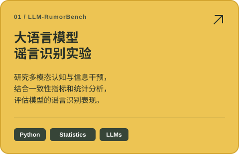
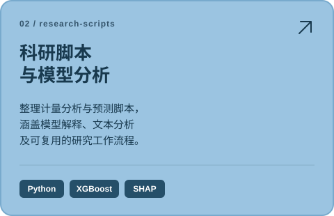
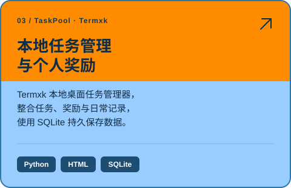

  

  <a href="README.md">English</a> &nbsp; / &nbsp; <strong>简体中文</strong>

  <strong>闽江大学</strong> 

  

  <a href="#tools--systems">技术与工具</a> &nbsp; / &nbsp;
  <a href="#qualifications">语言与资质</a> &nbsp; / &nbsp;
  <a href="#selected-work">精选项目</a> &nbsp; / &nbsp;
  <a href="#github-at-a-glance">代码概览</a> &nbsp; / &nbsp;
  <a href="#research--publications">研究与论文</a>

---

## 技术与工具

<h4>编程语言</h4>

  
  
  
  

<h4>AI 与研究工具</h4>

  
  
  
  
  

<h4>基础设施</h4>

  
  
  
  

<h4>自动化</h4>

  

数据清洗与整合 · 统计分析 · 预测方案对比 · 结果可视化

[科研脚本 ↗](https://github.com/Lichao-Lin/research-scripts) &nbsp; · &nbsp; [学习笔记与技能 ↗](https://github.com/Lichao-Lin/notebook)

## 语言与资质

- **英语六级（CET-6）**
- **低压电工证**

## 精选项目

<table>
  <tr>
    <td width="50%" valign="top"></td>
    <td width="50%" valign="top"></td>
  </tr>
  <tr>
    <td width="50%" valign="top"></td>
    <td width="50%" valign="top"></td>
  </tr>
</table>

---

## 代码概览

  
  

公开、未归档的原创仓库统计 · 自动更新 · 语言分布反映代码量，不代表熟练程度

活动统计卡片由 <a href="https://github.com/Lichao-Lin/github-readme-stats">GitHub Readme Stats</a> 生成

## 研究与论文

### 01 / 跨资产波动率预测

**Cross-Asset Volatility Forecasting with HAR-Guided LSTM Residual Learning**

`IIIHSMP · 会议接收`

基于多源金融数据构建 HAR–LSTM 融合深度学习预测模型，完成数据清洗与整合、方案对比和结果可视化。

### 02 / 大语言模型谣言识别

**Evaluating the Impact of Multimodal Cognitive and Informational Interventions on Rumor Detection in Large Language Models: A DeepSeek Case Study**

`IEEE Xplore · 已收录` &nbsp; `EI Compendex · 已收录`

分析多模态认知与信息干预对大语言模型谣言识别能力的影响，构建多视角评估体系。使用 Python 进行数据处理与统计分析，采用 Spearman 相关系数、Cohen’s κ 和加权 κ 等指标，比较模型输出与真实标签的一致性，并对实验结果进行多维度解释。

[论文 DOI ↗](https://doi.org/10.1109/CAIBDA65784.2025.11183156) &nbsp; · &nbsp; [实验仓库 ↗](https://github.com/Lichao-Lin/LLM-RumorBench)
